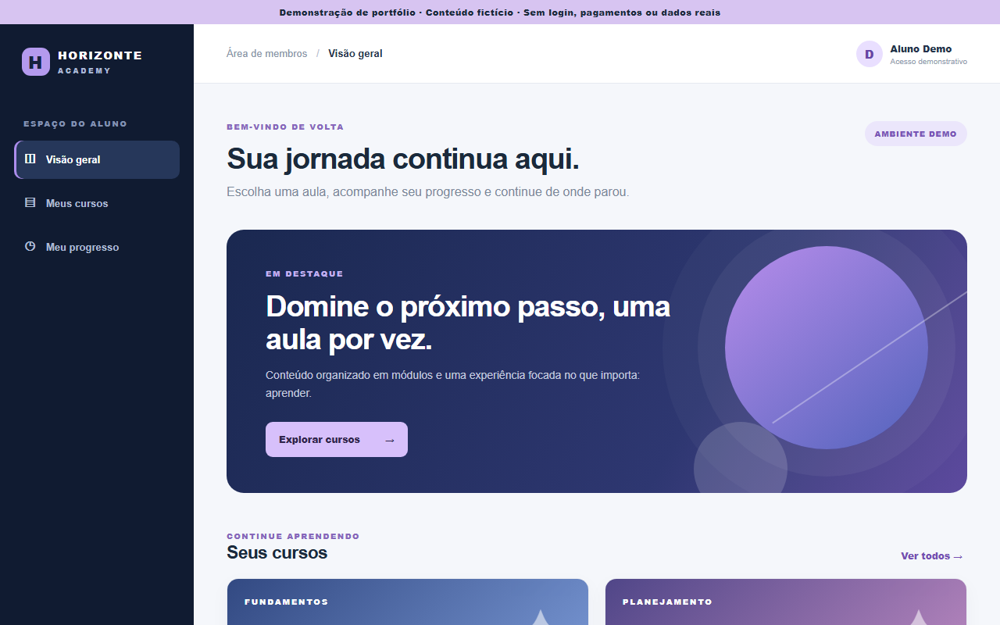

# Área de membros - interface de portfólio

Versão pública, fictícia e independente inspirada em um projeto privado de área de membros. **Não é o ambiente de produção** e não contém dados de alunos, vídeos, credenciais, integração com banco de dados ou conteúdo de clientes.

## Recursos

- Painel do aluno com cursos, aulas e indicadores de progresso.
- Busca por curso ou aula.
- Navegação responsiva e estados acessíveis para menu e progresso.
- Progresso local via `localStorage`, limitado ao navegador do visitante.

## Executar localmente

Não há dependências. Abra `index.html` diretamente ou sirva a pasta com `python -m http.server 8000` e acesse `http://localhost:8000`.

## Limites intencionais

O botão de concluir aula altera apenas o progresso local no navegador. Não há autenticação real, autorização, pagamentos, vídeo externo ou API. A marca Horizonte Academy, os cursos e as aulas são fictícios. Este repositório não deve ser usado como sistema de membros em produção.
